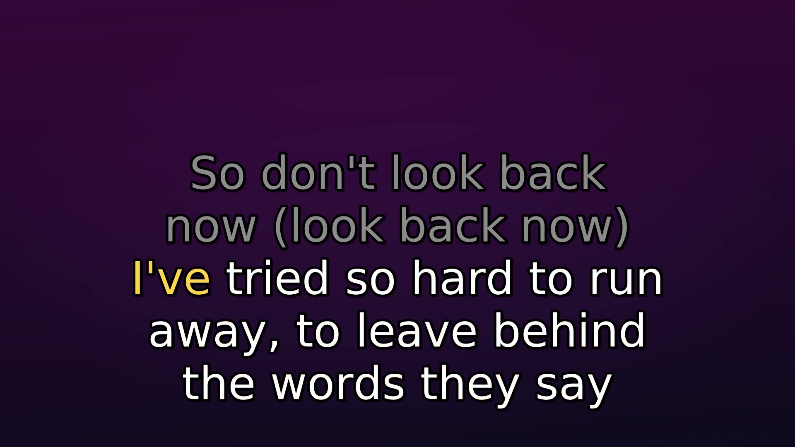
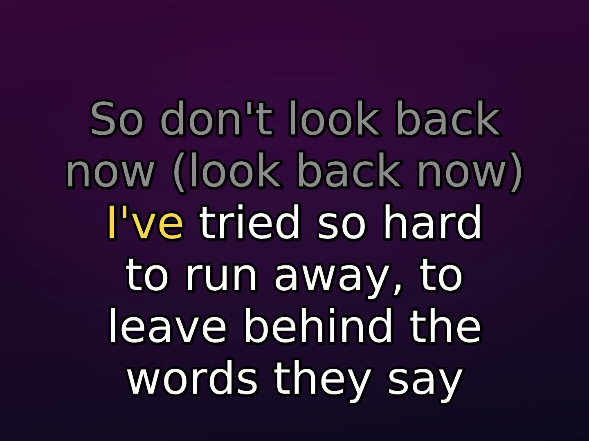
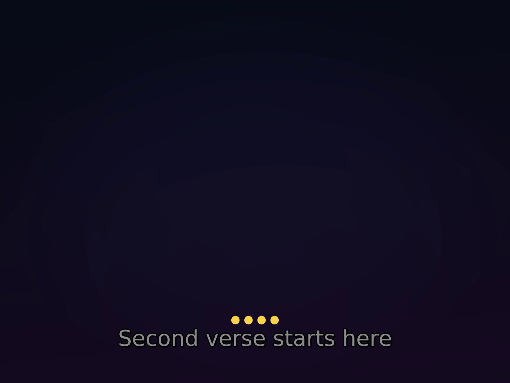
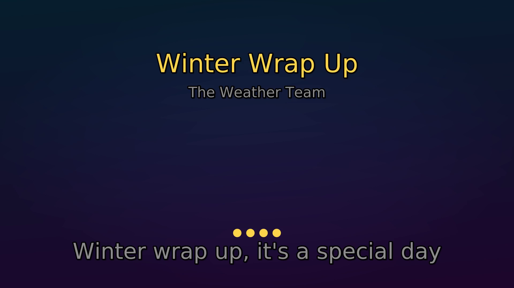

# KaraokeKit

**Tap-to-sync karaoke lyric video creator with progressive sweep styling and MP4/MKV export.**

KaraokeKit is a fast, native desktop app (Rust + `eframe`/`egui`) made to pair with
UVR5 instrumental and vocal stems. Load the instrumental, drop in the guide vocal,
paste the lyrics, and tap **Space** on every syllable. KaraokeKit turns those taps
into a smooth `\kf` sweep, previews it live at 1920×1080, and burns it into an
H.264 video with FFmpeg.


A rendered frame with the progressive sweep:



The same song exported as a true 4:3 canvas (`1440×1080`):



A lead-in countdown after a long instrumental gap — the dots step 4 → 3 → 2 → 1
above the on-deck line, then the sweep begins:



A 3.5 s title-card pre-roll: title and artist on the card, the opening line on
deck with a 4-dot entrance cue, then the audio and sweep begin together:



---

## Highlights

- **Dual stems, one clean export.** Instrumental + optional guide vocal, each with
  its own level and mute. The vocal is monitor-only; renders always use the
  instrumental file.
- **Tap-to-sync with syllable support.** `won/der/ful` becomes three sweepable
  tokens. Tap the next token with **Space**, undo with **Backspace** (which seeks
  back so you can re-tap on the fly), and nudge any token by ±25 ms.
- **16:9 and 4:3 canvases.** Choose Widescreen (1920×1080) or Classic 4:3
  (1440×1080). The preview stage is centered at the exact aspect and the `.ass`
  PlayRes/margins and FFmpeg canvas match 1:1.
- **Live preview.** The current line plus the next line above it (dimmed), with a
  per-syllable left-to-right fill. Stacking uses the real rendered height, so large
  fonts and wrapped lines never collide. Configurable font size, base/highlight
  colors, outline, shadow, bottom margin, and three background modes.
- **Waveform timeline.** Peak envelope with scrubbing, playhead, and lyric-line
  markers. Sample-accurate playback is provided by a dedicated CPAL mixer.
- **Real karaoke subtitles.** Export a standards-compliant `.ass` file that libass
  renders with `\kf` smooth-fill tags. The current line and the next line are
  burned in together (next line dimmed above), split at long pauses, with
  cumulative centisecond rounding (no drift on long lines).
- **MP4 and MKV.** H.264 video at 1920×1080 or 1440×1080, 30 or 60 fps. MP4 uses
  AAC 320k; MKV can use FLAC or AAC 320k. Live progress bar and cancel button.
- **Gap-aware .lrc import.** Blank `[mm:ss.xx]` end markers are honored, inferred
  word tails are bounded, and the current line clears during instrumental solos.
  The next line appears on deck only within a six-second lookahead.
- **Lead-in countdown.** When an upcoming line follows a gap of four seconds or
  more, a clean 4-dot cue counts down over the final 3.2 seconds (4 → 3 → 2 → 1),
  centered above the on-deck line. It clears the instant the sweep begins and is
  burned into the exported video. Toggle it in the Style panel.
- **Title-card pre-roll.** Add up to 6 s before the audio starts. The title and
  artist are centered on a clean card, the opening lyric waits on deck, and a
  4→3→2→1 cue counts down. Lyrics shift forward in the preview and export without
  changing stored tap timestamps; the audio is delayed to match. Includes an
  **Auto (3.5 s)** button for songs whose first lyric arrives almost immediately.
- **Self-contained Windows build.** All app assets (icon + DejaVu Sans) are embedded;
  the MSVC build statically links the C runtime, so `karaoke-kit.exe` does not need
  the VC++ Redistributable.
- **Projects you can reopen.** Save/load a `.json` project with timings, style and
  export settings, or import/export `.lrc` lyrics.

---

## Build & run

### Prerequisites

- Rust **1.95+** (tested with 1.99).
- **FFmpeg** on `PATH` (or set `KARAOKEKIT_FFMPEG`). The build must include
  `libx264`, `aac`, `flac` and `libass` — the standard FFmpeg packages on Linux and
  the `gyan.dev` / `ffmpeg.org` Windows builds do.
- Linux build/runtime libraries: ALSA, X11 and/or Wayland, OpenGL. On Arch:
  `alsa-lib libx11 libxkbcommon wayland`.
  No C source is compiled; these are system libraries used by CPAL/winit.
- On Linux, file dialogs use the XDG desktop portal (xdg-desktop-portal).
  Drag-and-drop works as a fallback everywhere.

### Linux

```bash
cd KaraokeKit
cargo run --release
```

The optimized binary is written to `target/release/karaoke-kit`.

### Windows (cross-compiled from Linux, static CRT)

```bash
rustup target add x86_64-pc-windows-msvc
cargo install cargo-xwin            # once
cargo xwin build --release --target x86_64-pc-windows-msvc
```

Output: `target/x86_64-pc-windows-msvc/release/karaoke-kit.exe`.

`.cargo/config.toml` adds `-C target-feature=+crt-static` for this target only.
Verify the result imports no `VCRUNTIME140.dll`:

```bash
objdump -p target/x86_64-pc-windows-msvc/release/karaoke-kit.exe \
  | grep -i "DLL Name"
```

`cargo-xwin` uses Microsoft's static CRT libraries, which ship without PDBs.
`.cargo/config.toml` passes `/ignore:4099` for this target, so the cross-build stays
quiet; the executable is unaffected.

### Open a project at launch

```bash
karaoke-kit song.json
karaoke-kit song.lrc
```

### Headless render (batch / automation)

```bash
karaoke-kit --render song.json --out song.mp4
karaoke-kit --render song.json --out song.mkv --format mkv --codec flac --fps 60
karaoke-kit --render song.json --out song.mp4 --crf 16 --preset slow
karaoke-kit --help
```

The headless path uses the exact same ASS, background and FFmpeg code as the GUI.

---

## Tap-sync workflow

1. **Load the instrumental** (FLAC/WAV/MP3/OGG). The waveform appears and playback
   becomes available.
2. *(Optional)* **Load the guide vocal**, set its monitor level, and mute/unmute it
   while tapping. It never appears in the exported mix.
3. Click **Edit lyrics** and paste the song with **Ctrl+V**, **right-click → Paste**,
   or the **Paste from clipboard** button. Put `/` inside a word to split
   syllables: `won/der/ful day`. Apply to tokenize (this resets timings).
4. Click **Start tapping**. KaraokeKit seeks slightly before the first untimed token
   and starts playing.
5. Press **Space** as each highlighted syllable is sung. The next token advances
   automatically and the list follows.
6. Made a mistake? **Backspace** un-stamps the last token and seeks back 150 ms;
   **Shift+Backspace** un-stamps without seeking. Re-tap with **Space**.
7. Fine-tune with the **−25 / +25** buttons (or `,` / `.`), or select a token and
   click **@** to stamp it at the current playhead.
8. Adjust **Offset** for output latency (Bluetooth speakers, HDMI, etc.). This
   shifts every lyric at once without changing the raw taps.
9. Switch to **Style** to tune the sweep, then **Export** to render.

### Keyboard

| Key | Action |
|---|---|
| `Space` | Tap the next syllable (or play/pause when Tap mode is off) |
| `Enter` | Play / pause |
| `Backspace` | Undo the last tap and seek back to re-tap |
| `Shift+Backspace` | Undo the last tap without seeking |
| `←` / `→` | Seek 5 s (hold `Shift` for 1 s) |
| `Home` | Seek to the start |
| `,` / `.` | Nudge the selected token by ±25 ms |
| `Ctrl+S` / `Ctrl+Shift+S` | Save project / save as |
| `Ctrl+O` | Open project or LRC |
| `Ctrl+V` | Paste lyrics (also right-click → Paste in the editor) |
| `F1` | Shortcut help |

Shortcuts are suppressed while the lyrics editor or a text field has focus.

---

## Lyrics & subtitle details

### Tokenization

- Lines are separated by newlines; blank lines are ignored.
- Whitespace separates words.
- `/` splits a word into syllables; each syllable gets its own timestamp and sweep.
- Punctuation stays attached to the token (`ful,`), and Unicode is preserved.

### LRC

- **Import** accepts plain `[mm:ss.cc]` line stamps and enhanced
  `<mm:ss.cc>` word tags, plus `ti`, `ar` and `offset` metadata.
- A blank timestamp line (`[mm:ss.xx]` with no text) is an explicit **end
  boundary** for the preceding line.
- Without a marker, starts are distributed inside a natural budget of
  `800 ms × syllables`; the last syllable's tail is capped at 1.2 s. A verse before
  a long solo therefore ends cleanly instead of stretching through it.
- During a gap the active line is cleared. The next line appears on deck at the
  bottom only within six seconds of its start, and its timestamp is preserved
  exactly.
- If **Lead-in countdown** is enabled and the gap is at least four seconds, the
  final 3.2 s show a 4→3→2→1 dot cue above the on-deck line (including before the
  very first line when it starts at 4 s or later). The dots disappear exactly at
  the next line's start.
- **Export** writes `ti`/`ar` and one `[mm:ss.cc]` line stamp, plus a blank end
  marker when a line has an explicit boundary and a gap follows. Timestamps are
  audio-relative: a title-card pre-roll is subtracted on export, so the LRC lines
  up with the original instrumental and re-importing it does not shift twice.

### ASS

- With a title-card pre-roll, `Title` and `Artist` events run from `0` to the
  pre-roll end, centered at 22% / 32% of the frame. The opening line and its
  pre-roll 4-dot cue are at the bottom; all lyric events use the shifted
  timeline (+pre-roll).
- PlayRes matches the selected canvas: `1920×1080` or `1440×1080`. Side margins
  are 134 px or 101 px, giving both aspects an 86% text-wrap width like the preview.
- One bottom-anchored event per lyric segment. When the next line is within the
  six-second lookahead, the event also contains it above the current one, switched
  with `{\rNext}` / `\N` / `{\rKaraoke}`. libass measures the wrapped block itself,
  so the next line cannot overlap the sweep.
- Events end at the line's explicit or inferred end. The current line is **not**
  held through an instrumental gap; instead a `Next`-style on-deck event covers
  the last six seconds before the next line.
- The first line is shown dimmed at the bottom only once it is within the lookahead
  window before its start.
- A `Countdown` style (gold, half the lyric font size, no outline) is used in the
  same bottom-anchored block as the on-deck line:
  `{\rCountdown}● ● ● ●\N{\rNext}next line`. Four events step the dots down
  4→3→2→1 over the 3.2 s lead-in; the last ends exactly at the next line's start.
- Every syllable is emitted as `{\kfNN}text`, where `NN` is rounded cumulatively so
  the line's total matches its subtitle duration.
- `PrimaryColour` is the **sung** highlight, `SecondaryColour` is the **unsung**
  base colour (libass karaoke convention). The `Next` style uses a dimmed base
  colour (55% brightness).
- Text is escaped for `{`, `}` and `\`; the bundled font is supplied through
  `fontsdir` so burned-in lyrics match the preview.

---

## Export options

| Option | Values |
|---|---|
| Container | `.mp4` or `.mkv` |
| Resolution | 1920×1080 (16:9) or 1440×1080 (4:3) |
| Frame rate | 30 or 60 fps |
| Video | H.264 (`libx264`, CRF 14–28, yuv420p, High profile) |
| Audio (MP4) | AAC 320 kbps |
| Audio (MKV) | FLAC (lossless) or AAC 320 kbps |
| Background | dark gradient · cover image (blur/dim) · looping video (dim) |
| Title-card pre-roll | 0–6 s in 0.5 s steps (audio delayed with `adelay`, video extended by the same amount) |

Rendering runs in a background thread with a progress bar, speed readout and cancel.
On cancel or failure the partial output file is removed. If FFmpeg is missing, the
app shows an actionable install hint instead of failing silently.

Video background note: the editor preview shows a still frame extracted with FFmpeg;
the render loops the full background video for the song's duration.

---

## Project format

Projects are pretty-printed JSON (`version: 1`). Timestamps are raw milliseconds
and are shifted by `tap_offset_ms` plus `intro_preroll_secs` when displayed,
previewed and rendered; the stored tap times themselves never change. A line
may carry an explicit `end_ms` (LRC blank markers); otherwise its end is inferred
from the last syllable and the next line, capped so long gaps do not stretch a
verse. Token ends are clamped to the line end. Older project files without
`aspect` load as 16:9.

```json
{
  "version": 1,
  "title": "Winter Wrap Up",
  "artist": "The Weather Team",
  "instrumental": "/music/winter_wrap_up.flac",
  "vocal": "/music/winter_wrap_up_vocals.flac",
  "lines": [
    {
      "end_ms": null,
      "tokens": [
        { "text": "win", "word_start": true,  "start_ms": 1200, "end_ms": null },
        { "text": "ter", "word_start": false, "start_ms": 1450, "end_ms": null }
      ]
    }
  ],
  "style": {
    "font_family": "DejaVu Sans",
    "font_size": 74.0,
    "base_color": [255, 255, 255],
    "highlight_color": [255, 213, 74],
    "outline_width": 3.0,
    "shadow_width": 2.0,
    "margin_v": 96.0,
    "lead_in_countdown": true,
    "intro_preroll_secs": 0.0,
    "background": { "mode": "gradient", "top": [11, 16, 32], "bottom": [27, 15, 43] }
  },
  "export": {
    "aspect": "16:9",
    "container": "mp4",
    "fps": 30,
    "audio_codec": "aac",
    "crf": 18,
    "preset": "medium"
  },
  "tap_offset_ms": 0,
  "tail_ms": 900
}
```

`background.mode` can be `gradient`, `cover` (`path`, `blur`, `dim`) or `video`
(`path`, `dim`). Paths are stored as given; absolute paths are recommended if you
move the project file.

---

## Verification

```bash
cargo fmt --check
cargo clippy --all-targets -- -D warnings
cargo test
cargo build --release
cargo xwin build --release --target x86_64-pc-windows-msvc
```

Unit and integration tests cover:

- `/` tokenization (including Unicode and empty syllables) and token joins.
- `\kf` centisecond rounding and ASS timestamp formatting.
- ASS generation: karaoke tags, color mapping, next-line/intro/on-deck events,
  pause splitting, escaping, and 16:9 vs 4:3 PlayRes/margins.
- LRC parsing (plain, enhanced, metadata, multiple stamps, blank end markers,
  12-second gaps) and export.
- Lead-in countdown: 4/3/2/1 phases, gaps under four seconds, the first-line case,
  the disabled setting, JSON defaulting, and matching ASS countdown events.
- Title-card pre-roll: +3.5 s ASS shifts, title/artist + pre-roll dot events, the
  audio `adelay`/total duration, stored token timestamps staying untouched, and
  old projects defaulting to 0 s.
- JSON project round-trips with `winter_wrap_up.json`, `cafeteria_song.lrc`, and
  `instrumental_gap.lrc` fixtures.
- Aspect metrics/defaults, line intervals, strict active-line and six-second
  on-deck helpers.
- Timing derivation, offsets, nudging, validation.
- FFmpeg argument construction for MP4/AAC and MKV/FLAC, progress parsing, gradient
  PNG generation, waveform peaks, and the generated icon.

The rendered examples above were produced with the real FFmpeg pipeline on Linux.

---

## Bundled font

`assets/fonts/DejaVuSans.ttf` is embedded for preview/export consistency and
redistributed under the Bitstream Vera/DejaVu license; see
`assets/fonts/LICENSE-DejaVu.txt`. The egui/eframe GUI also embeds the Hack and
Ubuntu Light fallback fonts. Full notices and license texts for all bundled
fonts and Rust dependencies are in
[THIRD_PARTY_NOTICES.md](THIRD_PARTY_NOTICES.md) and `licenses/`.

The app falls back to a generated icon if `assets/icon.png` is missing;
regenerate it with:

```bash
cargo run --release --example gen_icon
```

## Limitations

- Background video is looped for the full song; only a still frame is shown in the
  editor preview.
- Long lyric lines are wrapped by both libass and the preview, but automatic
  hyphenation is not performed. At extreme font sizes, a very tall current+next
  block may reach the top edge of the frame; lines still stack without overlapping.
- The title card uses fixed title/artist positions (22% / 32% of the frame). At
  very large font sizes the title, artist, and on-deck opening line can crowd
  each other; reduce the font size or pre-roll-free layout if that matters.
- 4:3 backgrounds are center-cropped from the source image/video (no stretching).
  Use a source with the intended 4:3 framing if cropping would cut important detail.
- LRC import is an approximation for plain (non-enhanced) files; tap-sync is the
  precise path.
- The bundled font covers Latin/Greek/Cyrillic and many symbols; for other scripts,
  choose an installed system font family in the Style panel (libass will use the
  system font, while the preview may substitute).

## License

KaraokeKit is MIT © 2026 KaraokeKit contributors. See [LICENSE](LICENSE).
Bundled fonts and third-party crates keep their own licenses; see
[THIRD_PARTY_NOTICES.md](THIRD_PARTY_NOTICES.md) and `licenses/`.
